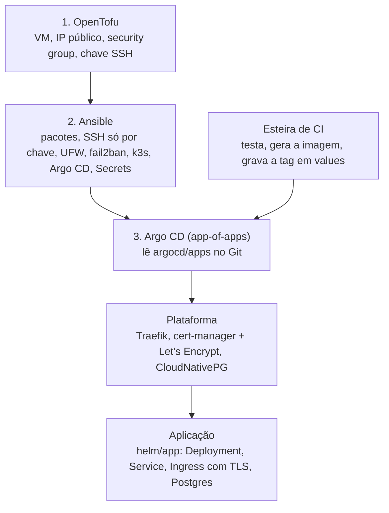

# k3s-gitops-vps

[](https://github.com/Thithio/k3s-gitops-vps/actions/workflows/ci.yml) 

Template para subir uma aplicação web numa VPS com tudo declarado no Git: a VM por OpenTofu, o sistema por Ansible e o cluster por Argo CD. Kubernetes de nó único com k3s, para quem quer GitOps sem pagar um cluster gerenciado.

A ideia é poder perder a máquina e recriar tudo a partir do repositório. Os dados são a exceção: eles só voltam de backup (ver "O que fica fora").

## Camadas



| Pasta | O que tem |
|---|---|
| `tofu/` | VM na Magalu Cloud com security group (SSH só dos seus IPs, 80/443 abertos). Troque o provider para usar outro provedor. |
| `ansible/` | Roles `admin_user`, `base`, `k3s` e `bootstrap`. Idempotente: pode rodar de novo. |
| `argocd/` | `root.yaml` (app-of-apps) e `apps/` com a plataforma e a aplicação. |
| `platform/` | Versões fixadas dos charts, valores do Traefik e os ClusterIssuers. |
| `helm/app/` | Chart genérico: um container HTTP com probes, Ingress com TLS e Postgres opcional. |

## Decisões

- **k3s de nó único, com o Traefik embutido desligado.** O Traefik vem pelo Argo CD, com versão e valores no Git.
- **Secrets do Kubernetes cifrados em disco** (`secrets-encryption: true`) e segredos versionados só dentro do Ansible Vault.
- **SSH só por chave, sem root, com fail2ban e UFW.** O UFW vale também para provedor que não tem security group.
- **A porta 6443 não fica aberta.** O kubeconfig vem para a máquina local e o acesso é por túnel SSH.
- **O banco não roda como superuser para a aplicação.** O CloudNativePG cria o dono `app` e o Secret com a `uri`, que vira `DATABASE_URL`.
- **Versões fixadas** de k3s, Argo CD e charts. Atualizar é uma mudança de propósito, com commit.

## Como usar

Pré-requisitos: `tofu`, `ansible`, uma chave SSH e um repositório Git (este, copiado para a sua conta).

1. **Troque os placeholders.** Procure por `SEU_USUARIO`, `SEU_REPO`, `SUA_APP`, `SUA_CHAVE`, `example.com` e `IP.DA.VM`:
   ```bash
   grep -rn "SEU_USUARIO\|SEU_REPO\|SUA_APP\|SUA_CHAVE\|example.com\|IP.DA.VM" .
   ```
2. **VM.** Pule se o provedor não tiver API e você criar a VM no painel.
   ```bash
   cd tofu
   cp terraform.tfvars.example terraform.tfvars   # sua chave pública e seu IP
   export TF_VAR_mgc_api_key=...                   # não vai para o git
   tofu init && tofu plan && tofu apply
   tofu output ansible_inventory_line              # cole em ansible/inventory/homolog.ini
   ```
3. **Inventário e segredos.**
   ```bash
   cd ansible
   cp inventory/homolog.ini.example inventory/homolog.ini
   cp group_vars/homolog/vault.example.yml group_vars/homolog/vault.yml   # preencha
   echo 'senha-do-vault' > .vault-pass && chmod 600 .vault-pass
   ansible-vault encrypt group_vars/homolog/vault.yml
   ansible-galaxy collection install community.general ansible.posix
   ```
4. **Usuário administrativo** (só se a VM vier apenas com root):
   ```bash
   ansible-playbook admin-user.yml -e ansible_user=root
   ```
5. **Servidor, Argo CD e segredos.** Antes das tarefas com a tag `gitops`, cadastre a deploy key (chave pública) no repositório como somente leitura.
   ```bash
   ansible-playbook site.yml
   ```
6. **Endereço.** Aponte um registro A para o IP da VM ou use `app.<ip-com-traços>.sslip.io` em `helm/app/values-homolog.yaml`, e faça commit. O Argo CD aplica sozinho.

Depois disso, deploy é commit: a esteira de CI troca `image.tag` em `helm/app/values-homolog.yaml` e o Argo CD sincroniza.

Acesso ao cluster pela máquina local:

```bash
ssh -N -L 6443:127.0.0.1:6443 deploy@IP.DA.VM &
KUBECONFIG=ansible/.kubeconfig-homolog kubectl get applications -n argocd
```

## O que fica fora

- **Backup e restore do banco.** Código recria máquina, cluster e aplicação, mas não recria dado. Para produção, ligue o backup contínuo do CloudNativePG (plugin barman-cloud) para um bucket de outro provedor e ensaie a recuperação.
- **Estado do OpenTofu.** Fica local. Para recuperação de desastre, mova para um bucket versionado.
- **Esteira de CI.** Depende da sua aplicação; o contrato com este repositório é só gravar a tag da imagem no `values`.

## Licença

MIT
